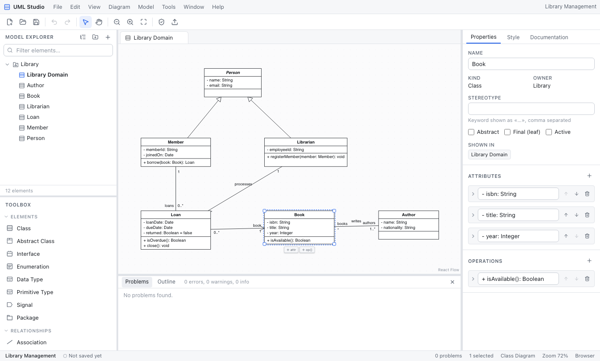

# UML Studio

UML Studio is a local-first UML modeler that keeps semantics and diagrams apart. You build a model of
classes, use cases, lifelines, states and so on, and every diagram shows views of that model. If you
rename a class in one diagram, it is renamed everywhere. Deleting a view does not delete the element
unless you ask for that. Undo and redo cover every edit. It runs in the browser today. A Tauri 2 desktop
shell is included but has not been compiled yet (see [Desktop app](#desktop-app-tauri-2)).



**Status at a glance** (details in [docs/DIAGRAM_CAPABILITIES.md](docs/DIAGRAM_CAPABILITIES.md)):

| Status | Diagrams |
| --- | --- |
| Complete for the documented scope | Class, Use Case, Sequence, Activity, State Machine |
| Partial (create, edit, save, export work; narrower notation and checks) | Package, Object, Component, Deployment, Composite Structure, Communication, Profile, Information Flow |
| Planned (listed but not creatable) | Timing, Interaction Overview |

Other features: `.umls` project files with crash recovery, SVG/PNG/PDF export, Mermaid/PlantUML text
export, TypeScript/Java/Python skeleton generation, a validation panel, nine templates, English and
French, light and dark themes, and an **experimental** StarUML `.mdj` importer for the class, use case
and package subset. The importer has only been tested with hand-written sample files. UML Studio does
not claim StarUML compatibility.

## Requirements

| Tool | Version | Needed for |
| --- | --- | --- |
| Node.js | ≥ 22.12 | everything |
| pnpm | 9.x (`corepack enable` or `npm i -g pnpm@9`) | everything |
| Playwright Chromium | installed with `pnpm exec playwright install chromium` | `pnpm test:e2e` |
| Rust (stable, via [rustup](https://rustup.rs)) | ≥ 1.77 | desktop app only |
| Xcode Command Line Tools (`xcode-select --install`) | any recent | desktop app on macOS |

The web app needs no Rust or native toolchain.

## Getting started

```bash
pnpm install
pnpm dev             # http://localhost:5173
```

| Command | What it does |
| --- | --- |
| `pnpm dev` | Vite dev server with hot reload on port 5173 |
| `pnpm build` | Typecheck, then production build into `dist/` (adds a strict Content-Security-Policy) |
| `pnpm preview` | Serve `dist/` on port 4173 |
| `pnpm typecheck` | `tsc --noEmit` for the app and for configs/tests (strict, `noUncheckedIndexedAccess`) |
| `pnpm lint` | ESLint (typescript-eslint strict), zero warnings allowed |
| `pnpm format` / `pnpm format:check` | Prettier write / verify |
| `pnpm test` | Vitest unit tests (domain, rendering, serialization, import, codegen, performance) |
| `pnpm test:e2e` | Playwright tests against a production build served on port 4173 |
| `pnpm tauri dev` / `pnpm tauri build` | Desktop app (Rust required) |

## Desktop app (Tauri 2)

The `src-tauri/` folder holds a Tauri 2 shell with native Open/Save dialogs. Every path you pick goes
on an allow-list, and file reads and writes are refused for any other path. Writes are atomic
(temporary file, fsync, rename), the app keeps a recent-files list, and a close guard runs when the
project has unsaved changes.

> **Not yet compiled.** The development machine had no Rust toolchain, so `pnpm tauri dev` and
> `pnpm tauri build` have never run and the Rust code is unverified. Everything else in this README
> has been run.

To build it on macOS:

```bash
xcode-select --install                       # if `clang --version` fails
curl --proto '=https' --tlsv1.2 -sSf https://sh.rustup.rs | sh
source "$HOME/.cargo/env"
pnpm tauri dev                               # desktop development window
pnpm tauri build                             # → src-tauri/target/release/bundle/macos/UML Studio.app (+ dmg/)
```

The build is unsigned, so Gatekeeper will block the first launch. Right-click the app, choose **Open**,
or run `xattr -dr com.apple.quarantine "UML Studio.app"`. Signing and notarization need an Apple
Developer ID and are not configured.

## Keyboard shortcuts

`Mod` means ⌘ on macOS and Ctrl elsewhere. The full list is in [docs/COMMANDS.md](docs/COMMANDS.md),
or press `Mod+/` in the app.

| Action | Shortcut | Action | Shortcut |
| --- | --- | --- | --- |
| New project | `Mod+N` | Command palette | `Mod+K` |
| Open | `Mod+O` | Search model | `Mod+P` |
| Save / Save As | `Mod+S` / `Shift+Mod+S` | Export image | `Shift+Mod+E` |
| Undo / Redo | `Mod+Z` / `Shift+Mod+Z`, `Mod+Y` | Rename | `F2` or `Enter` |
| Cut / Copy / Paste / Duplicate | `Mod+X` / `Mod+C` / `Mod+V` / `Mod+D` | Select all | `Mod+A` |
| Remove from diagram | `Delete` / `Backspace` | Delete from model | `Mod+Delete` |
| Zoom in / out / 100 % | `Mod+=` / `Mod+-` / `Mod+0` | Fit diagram | `Shift+1` |
| Select / Hand tool | `V` / `H` (hold `Space` to pan) | Nudge selection | arrows (`Shift` = grid step) |

## Where your work is stored

- **Project files** are `.umls` files: versioned, schema-validated JSON (see
  [docs/DATA_MODEL.md](docs/DATA_MODEL.md)). In Chromium browsers, Save overwrites the file you opened
  through the File System Access API. In Safari and Firefox, Open uses a file picker and Save downloads
  a new copy, and the start screen explains this.
- **Crash recovery**: 1.5 s after each edit, unsaved work is snapshotted to IndexedDB in this browser
  profile (or the desktop webview). On the next launch you are offered the snapshot. Snapshots are not
  backups. Saving or closing the project deletes them.
- Nothing is sent over the network. The production build's CSP blocks outbound connections.

## Troubleshooting (macOS)

| Symptom | Fix |
| --- | --- |
| `pnpm: command not found` | `corepack enable`, or `npm i -g pnpm@9`. If npm's global bin is not on `PATH`, add it, e.g. `export PATH="$(npm prefix -g)/bin:$PATH"`. |
| `Port 5173 is already in use` | Another dev server is running. Stop it (`lsof -i :5173`), because Tauri expects that fixed port. |
| E2E: `Executable doesn't exist … chromium` | `pnpm exec playwright install chromium` |
| E2E: `Port 4173 is already in use` | Stop a leftover `pnpm preview` (`lsof -i :4173`). |
| `pnpm tauri …`: `failed to run 'cargo metadata'` / `cargo: command not found` | Rust is missing. Install it with rustup (above), then open a new terminal. |
| `xcrun: error: invalid active developer path` | `xcode-select --install` |
| App "is damaged" / "cannot be opened" | Unsigned local build. See the Gatekeeper note above. |
| Save in Safari/Firefox downloads a new file | Expected: those browsers lack the File System Access API. Use Chromium or the desktop app to overwrite in place. |

## Documentation

- [Diagram capabilities](docs/DIAGRAM_CAPABILITIES.md): exact per-diagram status and evidence
- [Commands & shortcuts](docs/COMMANDS.md)
- [Architecture](docs/ARCHITECTURE.md) and [data model](docs/DATA_MODEL.md)
- [Test report](docs/TEST_REPORT.md) and [known limitations](docs/KNOWN_LIMITATIONS.md)
- Screenshots of the five core editors: [`docs/images/`](docs/images/)

## License

`package.json` and `src-tauri/Cargo.toml` declare `MIT` as a placeholder, and no `LICENSE` file is
included. Pick the license you want and add a `LICENSE` file before distributing.
